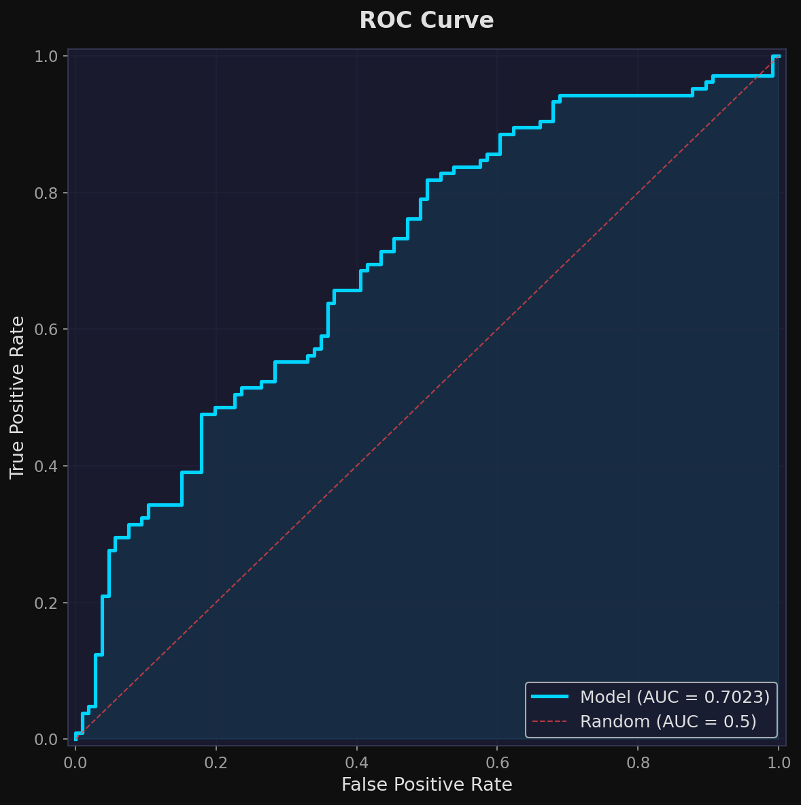
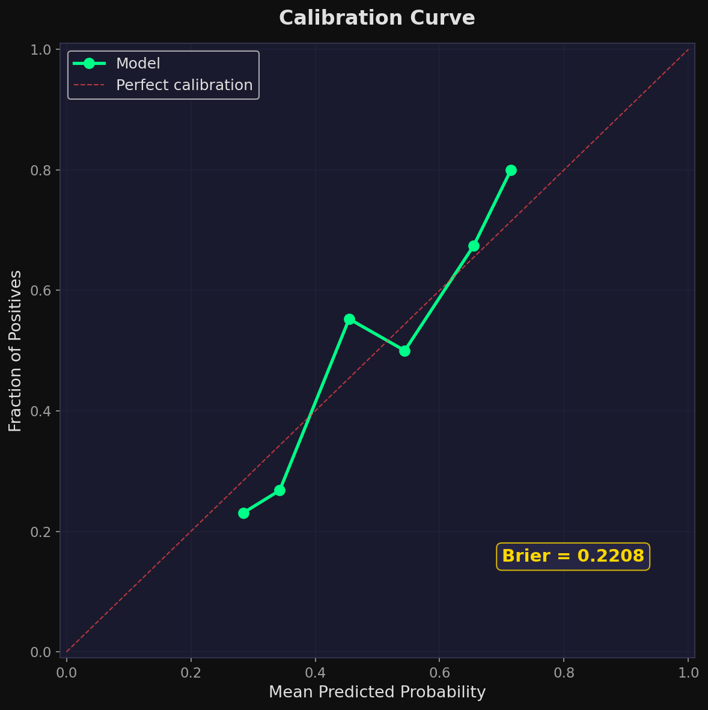
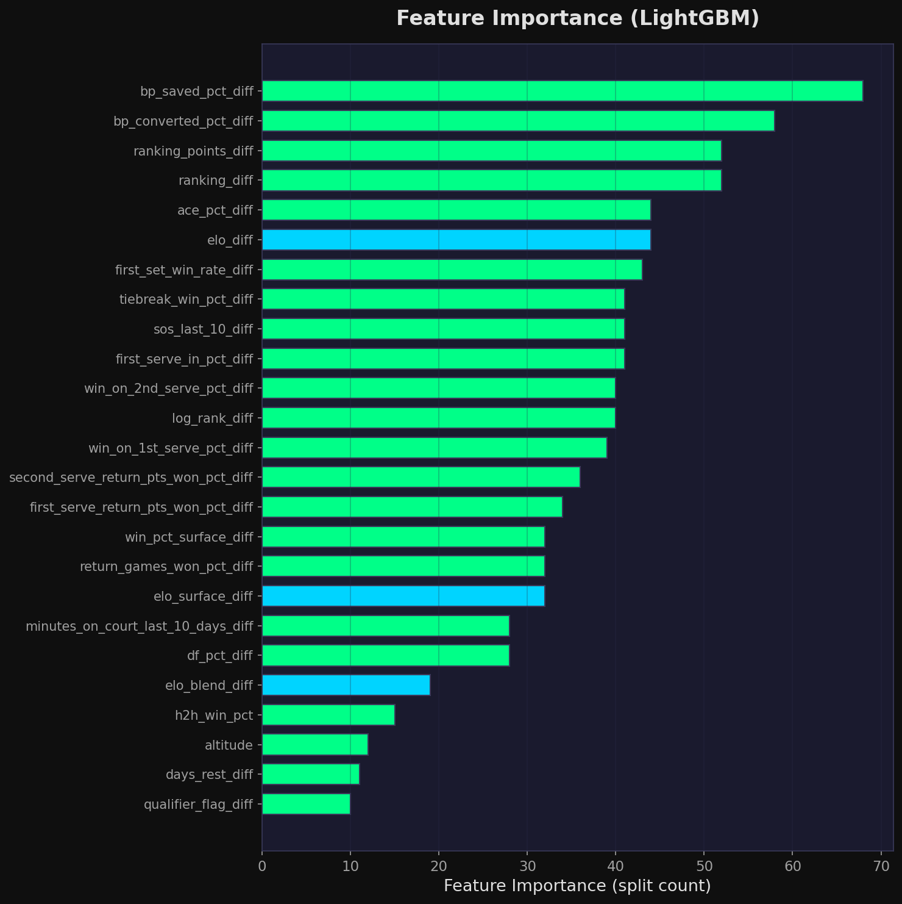
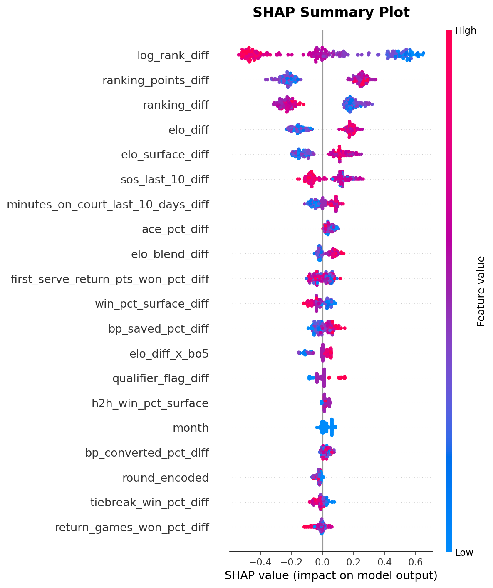
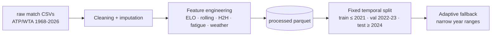
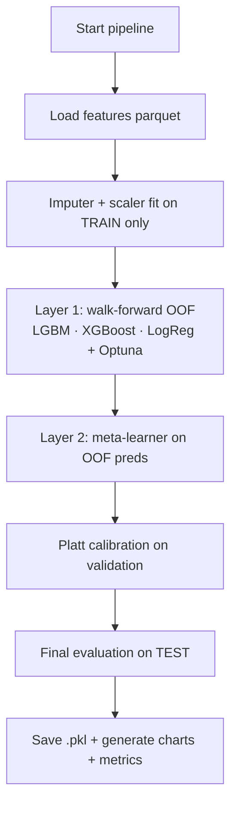
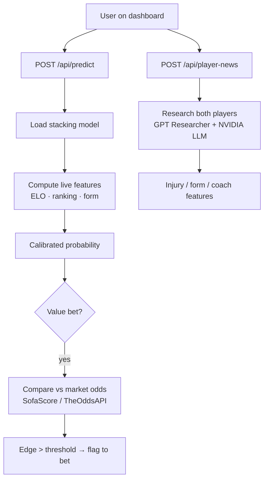
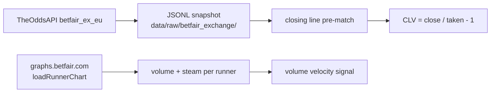

<div align="center">


<p><strong>End-to-end Machine Learning framework for ATP/WTA match prediction, live value-bet detection and automated model retraining.</strong></p>

<div>
  
  
  
  
  
  
</div>

<br/>

<div>
  
  
  
  
  
</div>

<br/>
<hr />
</div>

## 📌 Preview

| Dashboard Preview | Live Value Bet + Player News |
| :--- | :--- |
| Interactive dashboards for prediction, training, analytics and live markets (Next.js 16 + TypeScript + Tailwind). | Live odds from SofaScore / TheOddsAPI (incl. Betfair Exchange + Matchbook) compared against the model, plus LLM-driven (NVIDIA) news research on injuries, form and coach changes. |

<details open>
<summary><strong>🎯 Model diagnostics (auto-generated on every training run)</strong></summary>
<br>

| ROC Curve | Calibration Curve |
| :---: | :---: |
|  |  |

| Feature Importance | SHAP Summary |
| :---: | :---: |
|  |  |

</details>

> Charts are regenerated at every training run and saved to `reports/<tour>/` locally.
> They are also stored as GitHub Actions artifacts for every automated retrain.

---

## 🚀 Core Features

| Area | What it does |
| :--- | :--- |
| **Feature Engineering** | Global + surface-specific ELO, rolling statistics (10/20/30), head-to-head, fatigue, ranking, serve/break-point percentages, strength of schedule, weather (altitude), **odds features (opening/closing + line movement)** from tennis-data 2001-2026 (legacy columns included). |
| **Stacking Ensemble** | Layer 1: LightGBM + XGBoost + Logistic Regression with walk-forward out-of-fold predictions. Layer 2: meta-learner (Logistic Regression) on the OOF predictions. |
| **Probability Calibration** | Platt calibration on the validation set; ECE reports; Brier score before/after calibration. |
| **Walk-Forward Validation** | Strict temporal splits (train ≤ 2021, val 2022-2023, test ≥ 2024). Adaptive temporal-quantile fallback for narrow year ranges (e.g. single-year retraining) so training never crashes on empty folds. |
| **Live Odds Aggregation** | Multi-source: SofaScore (no API key, tier-1 pre-match + live odds), TheOddsAPI (with key — **Betfair Exchange `betfair_ex_eu` back+lay**, Matchbook, Pinnacle e 30+ bookmaker), OddsPortal scraper (decryption-based, 13 bookmaker mappati). Best-odds merge with margin calculation. |
| **Betfair Exchange CLV & Volume** | `betfair_historical.py`: snapshot JSONL dell'exchange Betfair (via TheOddsAPI) per calcolare la closing line e il CLV di ogni bet. `betfair_volume.py`: polling `graphs.betfair.com/loadRunnerChart` (senza login) per volume/steam per runner. |
| **Value-Bet Detection** | Compares model probability vs market-implied probability; flags edges above a configurable threshold. **Automatic Daily Card** (`/api/predict-card`): one click predicts EVERY match of the day for ATP/WTA with odds, edge and value-bet flags. |
| **Player News Research** | Autonomous research on injuries, form and coach changes via GPT Researcher + NVIDIA NIM (llama-3.1-8b), with regex fallback and LLM fact extraction. No empty fields. |
| **API Server** | FastAPI backend with health, predict, todays-matches (cached, stale-while-revalidate), value-bets, player-news, train/status, metrics, charts endpoints. |
| **Web Dashboard** | Next.js 16 dashboard: overview, prediction, analytics (ROC/calibration/SHAP/Brier charts), training control (Optuna trials, tour, year range), live market & value bets, player news research, live Python log streaming. |
| **Automated Retraining** | GitHub Actions scheduled weekly retrain (ATP+WTA) with artifact upload; manual dispatch supported. |
| **Security** | CI secret scan; API keys only in local `.env` (gitignored); neutral values when keys are missing. |

---

## 🧠 Architecture

```
┌────────────────────────────────────────────────────────────────────────┐
│                          WEB (Next.js 16 :3000)                        │
│  Dashboard · Predict · Analytics · Training · Markets · Player News    │
│  ─────────────── rewrites /api/* ──► FastAPI (proxy)                    │
└──────────────────────────────────────────────┬─────────────────────────┘
                                               │ http://localhost:9090
┌──────────────────────────────────────────────▼─────────────────────────┐
│                        API SERVER (FastAPI)                            │
│  /predict  /value-bets  /todays-matches(cached)  /player-news          │
│  /train/start  /status  /metrics  /charts  /health  /odds-api-status   │
└───────────────┬─────────────────────┬───────────────────┬──────────────┘
                │                     │                   │
   ┌────────────▼─────────┐ ┌─────────▼──────────┐ ┌──────▼─────────────┐
   │   LIVE ODDS          │ │   ML INFERENCE     │ │  NEWS RESEARCH     │
   │  SofaScore (no key)  │ │  stacking .pkl     │ │  GPT Researcher    │
   │  TheOddsAPI (key)    │ │  calibrated        │ │  NVIDIA NIM LLM    │
   │  Betfair exch (CLV)  │ │  imputer+scaler    │ │  DuckDuckGo search │
   │  OddsPortal scrape   │ │  odds-aware model  │ │                    │
   │  Matchbook exchange  │ │  odds1/odds2 in    │ │                    │
   │                      │ │  track log + edge  │ │                    │
   │                      │ │  avg_odds_edge     │ │                    │
   └────────────┬─────────┘ └─────────┬──────────┘ └────────┬───────────┘
                │                     │                     │
┌───────────────▼─────────────────────▼─────────────────────▼────────────┐
│                 TRAINING PIPELINE (backend/src/main.py)                │
│  download ─► features ─► split(walk-forward) ─► layer1 (LGBM/XGB/LR)  │
│  ─► layer2 meta ─► calibration ─► evaluation ─► reports + .pkl         │
└─────────────────────────────────────┬──────────────────────────────────┘
                                      │
        ┌─────────────────────────────▼────────────────────────────┐
        │  DATA: data/raw/*.csv ─► data/processed/*.parquet         │
        │  MODELS: models/saved/*.pkl  ·  REPORTS: reports/<tour>/  │
        └───────────────────────────────────────────────────────────┘
```

---

## 📁 Project Structure

```
tennisBOT-main/
├── start_all.py               # One-shot launcher for API + web
├── requirements.txt           # Runtime dependencies
├── requirements-dev.txt       # Lint/test/format dependencies (ruff, mypy, black, pytest)
├── ruff.toml                  # Ruff config (line-length 120, E/F/W)
├── mypy.ini                   # mypy config — strict = True, zero errors
├── .env.example               # Env template (copy → local.env; never commit keys)
│
├── backend/
│   ├── src/                   # import root — run entry points from here
│   │   ├── api_server.py      # FastAPI backend (port 9090)
│   │   ├── main.py            # CLI: download | features | train | predict | all
│   │   ├── config.py          # Paths + hyperparameters + Pydantic Settings (env/secrets)
│   │   ├── exceptions.py      # Domain exceptions
│   │   ├── logging_config.py  # Structured JSON logging
│   │   ├── smoke_test.py      # Import sanity checks
│   │   │
│   │   ├── api/
│   │   │   ├── routes/        # FastAPI routers (predict, card, track, training, ...)
│   │   │   ├── card_core.py   # Daily-card prediction logic (split from routes/card)
│   │   │   ├── predict_core.py # shared inference helpers
│   │   │   ├── historical_core.py
│   │   │   ├── schemas.py / state.py
│   │   │
│   │   ├── data/
│   │   │   └── download.py    # Jeff-Sackmann-style match data download
│   │   │
│   │   ├── features/
│   │   │   ├── elo.py                 # Global + surface ELO with K-factor, decay
│   │   │   ├── rolling_stats.py       # 10/20/30-match rolling aggregates
│   │   │   ├── h2h.py                 # Head-to-head features
│   │   │   ├── fatigue.py             # Recent workload/fatigue signals
│   │   │   ├── weather.py             # Altitude & weather context
│   │   │   ├── odds.py                # Tennis-data odds: legacy columns, Pinnacle/BFEX/B365, avg, opening/closing
│   │   │   ├── odds_aggregator.py     # Multi-source odds (SofaScore, TheOddsAPI, ...)
│   │   │   ├── oddsportal_scraper.py  # OddsPortal scraper (decryption-based)
│   │   │   ├── betfair_historical.py  # Exchange CLV JSONL snapshots
│   │   │   ├── betfair_volume.py      # graphs.betfair.com volume/steam polling
│   │   │   ├── live_odds.py           # Cached todays-matches (stale-while-revalidate)
│   │   │   ├── player_news.py         # LLM injury/form/coach research
│   │   │   ├── cleaning.py            # orchestrator → cleaning_loaders/transforms/enrichment
│   │   │   ├── builder.py             # orchestrator → builder_helpers + builder_symmetric
│   │   │   └── ...                    # context, player, news_signals, etc.
│   │   │
│   │   ├── pipeline/
│   │   │   ├── training.py            # Stacking training, Optuna, OOF
│   │   │   ├── train_oof.py / train_helpers.py  # OOF generation + data prep/meta
│   │   │   ├── evaluation.py          # ROC/AUC/Brier/LogLoss + charts
│   │   │   ├── eval_charts.py         # orchestrator → eval_charts_curves/explain/style
│   │   │   ├── calibration.py         # Platt calibration
│   │   │   ├── split.py               # Fixed temporal + adaptive walk-forward
│   │   │   ├── track.py / track_io.py # Certified track record
│   │   │   ├── inference.py           # Live tracker-state inference
│   │   │   └── betting_eval.py        # ROI/CLV betting backtest
│   │   │
│   │   └── utils/             # shared constants/helpers
│   │
│   └── tests/                 # pytest suite (51 tests)
│
├── data/
│   └── raw/ · processed/      # (gitignored) CSV → parquet
├── models/saved/              # (gitignored) *.pkl trained artifacts
├── reports/                   # (gitignored) metrics, charts per tour
├── scripts/                   # helpers (incl. security/check_no_secrets.py)
├── docs/
│   ├── architecture.md        # layout + path anchoring rules (AGENT.md)
│   └── assets/                # README preview charts
│
├── .github/workflows/
│   ├── ci.yml                 # Lint, format, type check, secret scan, tests, build
│   └── weekly_refresh.yml     # AUTOMATIC MODEL RETRAINING (weekly + manual)
│
└── frontend/                  # Next.js 16 dashboard
    ├── next.config.ts         # /api/* proxy → backend :9090
    ├── vitest.config.ts       # Vitest + Testing Library config (npm run test)
    └── src/
        ├── app/dashboard/     # overview, predict, analytics, training, markets, news
        ├── components/        # UI components (shadcn/ui) in own folders + index.ts
        ├── hooks/             # one hook per domain (useHistory, useTodaysMatches, ...)
        ├── services/          # typed API clients (no fetch in components)
        ├── types/             # shared types (src/types/api.ts)
        └── lib/               # api client (apiFetch), feature catalogue
```

---

## 🔄 Logical & Operational Flow

### 1. Data flow (one-time / periodic)


### 2. Training flow (on demand or automated)


### 3. Runtime (API + Web) flow


### 4. Operational cycle (automated weekly)
1. **Monday 04:00 UTC** GitHub Actions wakes up (`weekly_refresh.yml`)
2. Downloads the latest matches via data mirror
3. Rebuilds features, retrains ATP **and** WTA pure + odds models (Optuna 20 trials) — **ATP and WTA run as two parallel jobs**, so total wall time ≈ the slower tour (~halves runtime)
4. Runs the full evaluation suite (ROC, calibration, SHAP, Brier, ROI/CLV)
5. Uploads `models/saved/`, `reports/`, `data/processed/` as GitHub artifacts (14-day retention)
6. Optional: run the same job manually from `Actions → Weekly Refresh → Run workflow`

### 5. CLV / volume collection (continuous, free)


---

## 🏗️ Modeling Details

| Component | Detail |
| :--- | :--- |
| **Base learners** | LightGBM + XGBoost (Optuna-tuned, early stopping) + Logistic Regression |
| **Meta-learner** | Logistic Regression trained on out-of-fold probabilities |
| **Validation strategy** | Walk-forward, one-year validation folds (never random shuffle) |
| **Calibration** | Platt scaling on validation set (isotonic available) |
| **Metrics** | ROC-AUC, Brier, Log-loss, Accuracy, ECE, classification report |
| **Betting backtest** | ROI on positive-EV bets, CLV open→close line comparison |
| **Transparency** | Feature importance (LightGBM gains) + SHAP summary charts |

**Key features used by the model** (top of the importance list, from real runs):
`bp_saved_pct_diff`, `bp_converted_pct_diff`, `ranking_points_diff`, `ranking_diff`, `elo_diff`, `ace_pct_diff`, `first_set_win_rate_diff`, `tiebreak_win_pct_diff`, `sos_last_10_diff`, `first_serve_in_pct_diff`.

---

## 💾 Installation

### Prerequisites
- Python **3.10+** (tested on 3.12/3.13)
- Node.js **18+** (tested on 22)
- A free **TheOddsAPI** key (optional – odds features / live market tab)
- A free **NVIDIA Build API key** (optional – empowered player-news research)

### 1. Clone
```bash
git clone https://github.com/Tradeplusmore/tennisBOT.git
cd tennisBOT
```

### 2. Backend
```bash
python -m venv .venv
.venv\Scripts\activate            # Windows
# source .venv/bin/activate      # Unix
pip install -r requirements.txt
cp .env.example local.env        # edit with your keys (never commit!)
python backend/src/main.py download --tour atp
python backend/src/main.py features --tour atp
python backend/src/main.py train --tour atp --optuna-trials 20
```

### 3. API server
```bash
python backend/src/api_server.py
# → http://localhost:9090   (health at /api/health)
```
> The API listens on **9090** — outside Windows reserved/Hyper-V port ranges that previously blocked binds on 8010.

### 4. Web dashboard
```bash
cd frontend
npm install
npm run dev          # dev mode
# or
npm run build && npm run start   # production
# → http://localhost:3000  (proxies /api/* to :9090)
```

### 5. One-shot launcher
```bash
python start_all.py   # boots both API and web
```

---

## 🧪 Testing & Quality Gates

```bash
pip install -r requirements-dev.txt
ruff check .                                   # rules in ruff.toml (line-length 120)
black --check .                                # consistent formatting
cd backend/src && mypy --config-file ../../mypy.ini .   # mypy --strict, 0 errors
python scripts/security/check_no_secrets.py   # CI-required secret scan
pytest backend/tests -q                        # 51 tests
python backend/src/smoke_test.py               # import sanity
cd frontend && npx eslint src && npx tsc --noEmit && npm run test && npm run build
```

All gates run automatically in `.github/workflows/ci.yml` on every push/PR.
The backend is fully typed: `mypy.ini` enforces `strict = True` (no per-module
relaxations) and mypy reports **zero errors**. Frontend has a Vitest +
Testing Library suite (`npm run test`, 13 tests).

---

## 🌐 API Reference (highlights)

| Method | Route | Description |
| :--- | :--- | :--- |
| GET | `/api/health` | Liveness check |
| GET | `/api/models` | List trained models |
| POST | `/api/predict` | `{player1, player2, surface, model, odds1?, odds2?}` → calibrated probability + features (missing odds auto-filled from live market) |
| GET | `/api/todays-matches?tour=atp` | Today's matches with best odds (cached, stale-while-revalidate) |
| GET | `/api/predict-card?tour=atp&min_edge=0.05` | **Automatic daily card**: model prediction + odds + edge vs market + value-bet flag for EVERY match of the day (ATP/WTA), surface inferred from tournament name |
| POST | `/api/value-bets` | Model vs market edge detection |
| POST | `/api/player-news` | `{player1, player2, surface}` → injury/form/coach features |
| POST | `/api/train/start` | `{tour, trials, startYear, endYear}` → launches training subprocess |
| GET | `/api/status` | Training progress + live log tail |
| GET | `/api/metrics?tour=atp` | CSV metrics summary |
| GET | `/api/charts` / `/api/charts/{name}` | Chart listing + PNG serving |
| GET | `/api/odds-api-status` | TheOddsAPI key check |

---

## 🔒 Security Notes

- **Never commit** `.env` / `local.env` — both are gitignored and contain live API keys.
- The previous `ODDS_API_KEY` (committed historically as `9b49...f83`) is considered **public — rotate it** on the-odds-api.com before relying on it.
- CI runs a secret scan (`check_no_secrets.py`) that fails the build if credentials are detected.
- Env/secret values are read centrally via Pydantic `BaseSettings`
  (`backend/src/config.py`, singleton `config.settings`) — no `os.environ.get`
  scattered across modules. `local.env` overrides `.env`.
- The API binds to `127.0.0.1` only, with restrictive CORS. On top of that, a
  CSRF guard middleware rejects any state-changing request (`POST/PUT/PATCH/
  DELETE`) whose browser `Origin` is not on the allow-list, so a malicious
  local page cannot trigger training/reload. Model filenames are regex-validated
  and path-anchored under `models/` before any `joblib.load`.

---

## 🤖 Automated Retraining (GitHub Actions)

The repo ships with **two workflows**:

1. **CI** — ruff lint, black format check, `mypy --strict`, secret scan, unit tests (pytest + Vitest), web build (every push / PR).
2. **Weekly Refresh** — full automatic retrain:
   - Runs every **Monday 04:00 UTC** (cron)
   - Manually triggerable: `Actions → Weekly Refresh → Run workflow` with tour / trials / settle-only inputs
   - Uploads models + reports + processed data as artifacts
   - `pip` caching for fast installs

No GPU needed — stacking on LightGBM/XGBoost trains on CPU within the 6h runner limit.

---

## 📊 Sample Results (real run, ATP 2000-2026, walk-forward test 2024-2026)

| Metric | ATP Test (7,192 matches) | WTA Test (6,900 matches) |
| :--- | :---: | :---: |
| ROC-AUC | 0.744 | 0.747 |
| Accuracy | 67.85% | 67.5% |
| Brier | 0.205 | 0.205 |
| Log-loss | 0.596 | 0.583 |
| ECE (10-bin) | 0.032 | 0.028 |
| **CLV avg (open → close)** | **+1.52% (94.6% beat)** | **+1.36% (92.2% beat)** |
| **ROI edge-band >10%** | **+15.5%** | **+26.1%** |

**Top features** (LightGBM importance): `ranking_diff`, `elo_surface_diff`, `win_on_1st_serve_pct_diff`, `sos_last_10_diff`, `win_on_2nd_serve_pct_diff`, `first_serve_return_pts_won_pct_diff`, `days_rest_diff`, `log_rank_diff`, `ace_pct_diff`, `first_serve_in_pct_diff`.

> **Honest market benchmark:** with the fixed odds pipeline (legacy tennis-data
> columns 2001-2014, Pinnacle/Betfair Exchange/Bet365 opening, Avg/Max closing,
> coverage 55% open / 69% close) the odds-aware **WTA model beats the closing
> market** on log-loss (0.5825 vs 0.5834) and both tours show **positive CLV**
> (+1.5% avg, ~93% beat rate) with strong ROI in the >10% edge segment. ATP
> opening-line benchmark still slightly ahead (0.5929 vs 0.5977); the exchange
> CLV snapshot pipeline (`backend/src/features/betfair_historical.py`) keeps accumulating
> the pre-match data needed to close that gap.

---

## 📄 Documentation Mirrors

- `AGENT.md` — project engineering rules (structure, naming, tooling, limits)
- `CHANGELOG.md` — version history (keepachangelog format)
- `docs/architecture.md` — repository layout, path anchoring, data flow
- `docs/DATA_SOURCES.md` — data source details
- `docs/SECURITY.md` / `SECURITY.md` — security policy
- `PROJECT_STATUS_REPORT.md` — endpoint/wiring status (historical snapshot)
- `COMPLETE_REPORT.md` — full technical report (historical snapshot)
- `MODEL_AUDIT.md` — leakage-avoidance audit (historical snapshot)

---

<div align="center">
    
    <p><em>Built with rigorous attention to data integrity and advanced ML principles.</em></p>
</div>