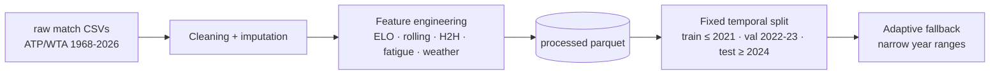
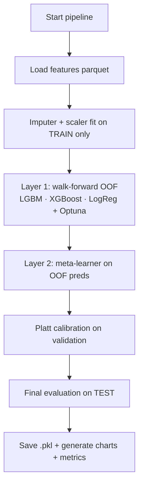
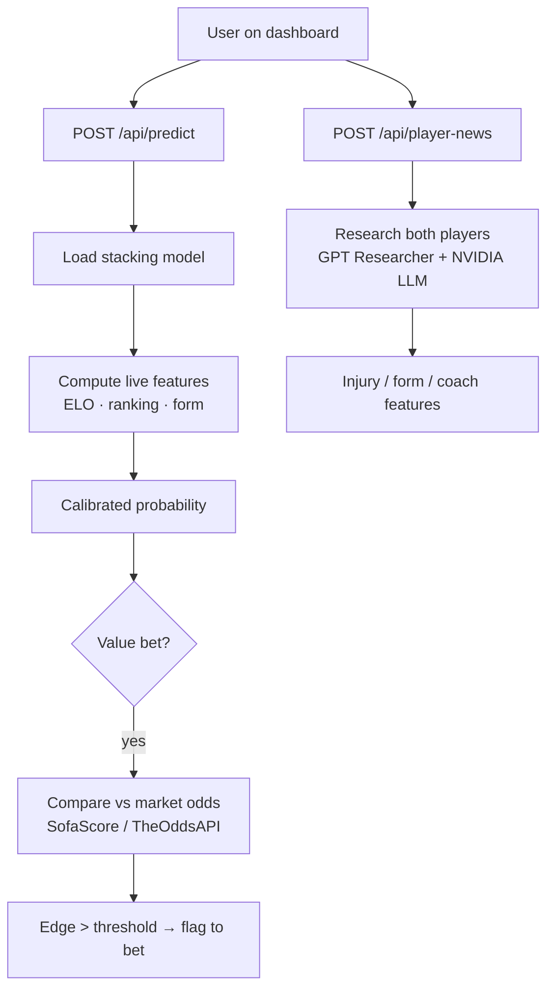

<div align="center">


<p><strong>End-to-end Machine Learning framework for ATP/WTA match prediction, live value-bet detection and automated model retraining.</strong></p>

<div>
  
  
  
  
  
  
</div>

<br/>

<div>
  
  
  
  
</div>

<br/>
<hr />
</div>

## 📌 Preview

| Dashboard Preview | Live Value Bet + Player News |
| :--- | :--- |
| Interactive dashboards for prediction, training, analytics and live markets (Next.js 16 + TypeScript + Tailwind). | Live odds from SofaScore / TheOddsAPI compared against the model, plus LLM-driven (NVIDIA) news research on injuries, form and coach changes. |

<details open>
<summary><strong>🎯 Model diagnostics (auto-generated on every training run)</strong></summary>
<br>

| ROC Curve | Calibration Curve |
| :---: | :---: |
|  |  |

| Feature Importance | SHAP Summary |
| :---: | :---: |
|  |  |

</details>

> Charts are regenerated at every training run and saved to `reports/<tour>/` locally.
> They are also stored as GitHub Actions artifacts for every automated retrain.

---

## 🚀 Core Features

| Area | What it does |
| :--- | :--- |
| **Feature Engineering** | Global + surface-specific ELO, rolling statistics (10/20/30), head-to-head, fatigue, ranking, serve/break-point percentages, strength of schedule, weather (altitude). |
| **Stacking Ensemble** | Layer 1: LightGBM + XGBoost + Logistic Regression with walk-forward out-of-fold predictions. Layer 2: meta-learner (Logistic Regression) on the OOF predictions. |
| **Probability Calibration** | Platt calibration on the validation set; ECE reports; Brier score before/after calibration. |
| **Walk-Forward Validation** | Strict temporal splits (train ≤ 2021, val 2022-2023, test ≥ 2024). Adaptive temporal-quantile fallback for narrow year ranges (e.g. single-year retraining) so training never crashes on empty folds. |
| **Live Odds Aggregation** | Multi-source: SofaScore (no API key, tier-1 pre-match + live odds), TheOddsAPI (with key), Betfair hook (placeholder). Best-odds merge with margin calculation. |
| **Value-Bet Detection** | Compares model probability vs market-implied probability; flags edges above a configurable threshold. |
| **Player News Research** | Autonomous research on injuries, form and coach changes via GPT Researcher + NVIDIA NIM (llama-3.1-8b), with regex fallback and LLM fact extraction. No empty fields. |
| **API Server** | FastAPI backend with health, predict, todays-matches (cached, stale-while-revalidate), value-bets, player-news, train/status, metrics, charts endpoints. |
| **Web Dashboard** | Next.js 16 dashboard: overview, prediction, analytics (ROC/calibration/SHAP/Brier charts), training control (Optuna trials, tour, year range), live market & value bets, player news research, live Python log streaming. |
| **Automated Retraining** | GitHub Actions scheduled weekly retrain (ATP+WTA) with artifact upload; manual dispatch supported. |
| **Security** | CI secret scan; API keys only in local `.env` (gitignored); neutral values when keys are missing. |

---

## 🧠 Architecture

```
┌────────────────────────────────────────────────────────────────────────┐
│                          WEB (Next.js 16 :3000)                        │
│  Dashboard · Predict · Analytics · Training · Markets · Player News    │
│  ─────────────── rewrites /api/* ──► FastAPI (proxy)                    │
└──────────────────────────────────────────────┬─────────────────────────┘
                                               │ http://localhost:9090
┌──────────────────────────────────────────────▼─────────────────────────┐
│                        API SERVER (FastAPI)                            │
│  /predict  /value-bets  /todays-matches(cached)  /player-news          │
│  /train/start  /status  /metrics  /charts  /health  /odds-api-status   │
└───────────────┬─────────────────────┬───────────────────┬──────────────┘
                │                     │                   │
   ┌────────────▼─────────┐ ┌─────────▼──────────┐ ┌──────▼─────────────┐
   │   LIVE ODDS          │ │   ML INFERENCE     │ │  NEWS RESEARCH     │
   │  SofaScore (no key)  │ │  stacking .pkl     │ │  GPT Researcher    │
   │  TheOddsAPI (key)    │ │  calibrated        │ │  NVIDIA NIM LLM    │
   │  Betfair (optional)  │ │  imputer+scaler    │ │  DuckDuckGo search │
   └────────────┬─────────┘ └─────────┬──────────┘ └────────┬───────────┘
                │                     │                     │
┌───────────────▼─────────────────────▼─────────────────────▼────────────┐
│                        TRAINING PIPELINE (main.py)                     │
│  download ─► features ─► split(walk-forward) ─► layer1 (LGBM/XGB/LR)  │
│  ─► layer2 meta ─► calibration ─► evaluation ─► reports + .pkl         │
└─────────────────────────────────────┬──────────────────────────────────┘
                                      │
        ┌─────────────────────────────▼────────────────────────────┐
        │  DATA: data/raw/*.csv ─► data/processed/*.parquet         │
        │  MODELS: models/saved/*.pkl  ·  REPORTS: reports/<tour>/  │
        └───────────────────────────────────────────────────────────┘
```

---

## 📁 Project Structure

```
tennisBOT-main/
├── api_server.py              # FastAPI backend (port 9090)
├── main.py                    # CLI: download | features | train | predict | all
├── config.py                  # Paths, hyperparameters, split boundaries
├── exceptions.py              # Domain exceptions
├── logging_config.py          # Structured JSON logging
├── smoke_test.py              # Import sanity checks
├── start_all.py               # One-shot launcher for API + web
├── requirements.txt           # Runtime dependencies
├── requirements-dev.txt       # Lint/test dependencies
├── .env.example               # Env template (copy → local.env; never commit keys)
│
├── data/
│   ├── download.py            # Jeff-Sackmann-style match data download
│   └── raw/ · processed/      # (gitignored) CSV → parquet
│
├── features/
│   ├── elo.py                 # Global + surface ELO with K-factor, decay
│   ├── rolling_stats.py       # 10/20/30-match rolling aggregates
│   ├── h2h.py                 # Head-to-head features
│   ├── fatigue.py             # Recent workload/fatigue signals
│   ├── weather.py             # Altitude & weather context
│   ├── odds_aggregator.py     # Multi-source odds (SofaScoreAdapter, ...)
│   ├── live_odds.py           # Cached todays-matches (stale-while-revalidate)
│   ├── player_news.py         # LLM injury/form/coach research
│   └── ...                    # builder, cleaning, context, player, odds
│
├── pipeline/
│   ├── training.py            # Stacking training, Optuna, OOF
│   ├── evaluation.py          # ROC/AUC/Brier/LogLoss + 5 charts
│   ├── calibration.py         # Platt calibration
│   ├── split.py               # Fixed temporal + adaptive walk-forward
│   └── betting_eval.py        # ROI/CLV betting backtest
│
├── models/saved/              # (gitignored) *.pkl trained artifacts
├── reports/                   # (gitignored) metrics, charts per tour
├── scripts/                   # helpers (incl. security/check_no_secrets.py)
├── tests/                     # pytest suite (25+ tests)
├── utils/                     # shared constants/helpers
├── docs/
│   └── assets/                # README preview charts
│
├── .github/workflows/
│   ├── ci.yml                 # Lint, type check, secret scan, tests, build
│   └── weekly_refresh.yml     # AUTOMATIC MODEL RETRAINING (weekly + manual)
│
└── web/                       # Next.js 16 frontend
    ├── next.config.ts         # /api/* proxy → backend :9090
    └── src/app/dashboard/     # overview, predict, analytics, training, markets, news
```

---

## 🔄 Logical & Operational Flow

### 1. Data flow (one-time / periodic)


### 2. Training flow (on demand or automated)


### 3. Runtime (API + Web) flow


### 4. Operational cycle (automated weekly)
1. **Monday 04:00 UTC** GitHub Actions wakes up (`weekly_refresh.yml`)
2. Downloads the latest matches via data mirror
3. Rebuilds features, retrains ATP **and** WTA pure + odds models (Optuna 20 trials)
4. Runs the full evaluation suite (ROC, calibration, SHAP, Brier, ROI/CLV)
5. Uploads `models/saved/`, `reports/`, `data/processed/` as GitHub artifacts (14-day retention)
6. Optional: run the same job manually from `Actions → Weekly Refresh → Run workflow`

---

## 🏗️ Modeling Details

| Component | Detail |
| :--- | :--- |
| **Base learners** | LightGBM + XGBoost (Optuna-tuned, early stopping) + Logistic Regression |
| **Meta-learner** | Logistic Regression trained on out-of-fold probabilities |
| **Validation strategy** | Walk-forward, one-year validation folds (never random shuffle) |
| **Calibration** | Platt scaling on validation set (isotonic available) |
| **Metrics** | ROC-AUC, Brier, Log-loss, Accuracy, ECE, classification report |
| **Betting backtest** | ROI on positive-EV bets, CLV open→close line comparison |
| **Transparency** | Feature importance (LightGBM gains) + SHAP summary charts |

**Key features used by the model** (top of the importance list, from real runs):
`bp_saved_pct_diff`, `bp_converted_pct_diff`, `ranking_points_diff`, `ranking_diff`, `elo_diff`, `ace_pct_diff`, `first_set_win_rate_diff`, `tiebreak_win_pct_diff`, `sos_last_10_diff`, `first_serve_in_pct_diff`.

---

## 💾 Installation

### Prerequisites
- Python **3.10+** (tested on 3.12/3.13)
- Node.js **18+** (tested on 22)
- A free **TheOddsAPI** key (optional – odds features / live market tab)
- A free **NVIDIA Build API key** (optional – empowered player-news research)

### 1. Clone
```bash
git clone https://github.com/Tradeplusmore/tennisBOT.git
cd tennisBOT
```

### 2. Backend
```bash
python -m venv .venv
.venv\Scripts\activate            # Windows
# source .venv/bin/activate      # Unix
pip install -r requirements.txt
cp .env.example local.env        # edit with your keys (never commit!)
python main.py download --tour atp
python main.py features --tour atp
python main.py train --tour atp --optuna-trials 20
```

### 3. API server
```bash
python api_server.py
# → http://localhost:9090   (health at /api/health)
```
> The API listens on **9090** — outside Windows reserved/Hyper-V port ranges that previously blocked binds on 8010.

### 4. Web dashboard
```bash
cd web
npm install
npm run dev          # dev mode
# or
npm run build && npm run start   # production
# → http://localhost:3000  (proxies /api/* to :9090)
```

### 5. One-shot launcher
```bash
python start_all.py   # boots both API and web
```

---

## 🧪 Testing & Quality Gates

```bash
pip install -r requirements-dev.txt
ruff check . --select E,F,W --ignore E501,E402
mypy --ignore-missing-imports .
python scripts/security/check_no_secrets.py   # CI-required secret scan
pytest tests/ -q                               # 25+ tests
python smoke_test.py                           # import sanity
cd web && npx eslint src && npx tsc --noEmit && npm run build
```

All gates run automatically in `.github/workflows/ci.yml` on every push/PR.

---

## 🌐 API Reference (highlights)

| Method | Route | Description |
| :--- | :--- | :--- |
| GET | `/api/health` | Liveness check |
| GET | `/api/models` | List trained models |
| POST | `/api/predict` | `{player1, player2, surface, model}` → calibrated probability + features |
| GET | `/api/todays-matches?tour=atp` | Today's matches with best odds (cached, stale-while-revalidate) |
| POST | `/api/value-bets` | Model vs market edge detection |
| POST | `/api/player-news` | `{player1, player2, surface}` → injury/form/coach features |
| POST | `/api/train/start` | `{tour, trials, startYear, endYear}` → launches training subprocess |
| GET | `/api/status` | Training progress + live log tail |
| GET | `/api/metrics?tour=atp` | CSV metrics summary |
| GET | `/api/charts` / `/api/charts/{name}` | Chart listing + PNG serving |
| GET | `/api/odds-api-status` | TheOddsAPI key check |

---

## 🔒 Security Notes

- **Never commit** `.env` / `local.env` — both are gitignored and contain live API keys.
- The previous `ODDS_API_KEY` (committed historically as `9b49...f83`) is considered **public — rotate it** on the-odds-api.com before relying on it.
- CI runs a secret scan (`check_no_secrets.py`) that fails the build if credentials are detected.
- API keys are read at runtime via `load_dotenv(override=True)`: `local.env` overrides `.env`.

---

## 🤖 Automated Retraining (GitHub Actions)

The repo ships with **two workflows**:

1. **CI** — lint, type-check, secret scan, unit tests, web build (every push / PR).
2. **Weekly Refresh** — full automatic retrain:
   - Runs every **Monday 04:00 UTC** (cron)
   - Manually triggerable: `Actions → Weekly Refresh → Run workflow` with tour / trials / settle-only inputs
   - Uploads models + reports + processed data as artifacts
   - `pip` caching for fast installs

No GPU needed — stacking on LightGBM/XGBoost trains on CPU within the 6h runner limit.

---

## 📊 Sample Results (real run, ATP 2026-only)

| Metric | Test Set | Validation Set |
| :--- | :---: | :---: |
| ROC-AUC | 0.702 | 0.695 |
| Accuracy | 63.5% | 65.4% |
| Brier | 0.221 | 0.223 |
| Log-loss | 0.632 | 0.638 |
| ECE (10-bin) | 0.061 | — |

> Numbers vary by year range and data window. The full-history model (2000-2026, ~127k matches) reaches higher AUC (~0.78 fold-level). Charts and `metrics_summary.csv` are regenerated for every run.

---

## 📄 Documentation Mirrors

- `CHANGELOG.md` — version history
- `PROJECT_STATUS_REPORT.md` — endpoint/wiring status
- `COMPLETE_REPORT.md` — full technical report
- `MODEL_AUDIT.md` — leakage-avoidance audit
- `docs/` — assets and extended docs

---

<div align="center">
    
    <p><em>Built with rigorous attention to data integrity and advanced ML principles.</em></p>
</div>